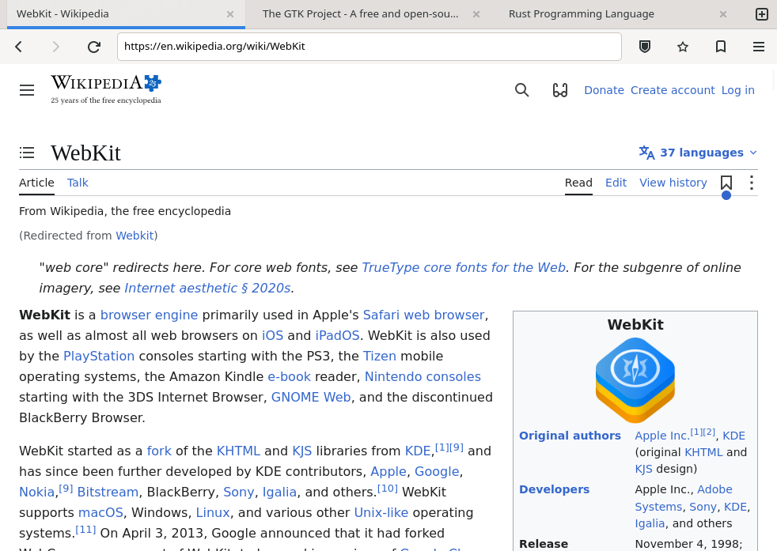

# BrowseGoo

BrowseGoo is a Web browser for the Linux desktop, built with
[WebKit](https://webkit.org/), [GTK4](https://www.gtk.org/), and [Rust](https://www.rust-lang.org/).

Created by [AI Sloperator](https://www.aisloperator.com/) with Claude Code.

Portions Copyright.  No license is given.

## Features

- A browser window with a location field, and back, forward and reload.
- Completion in the location field from the bookmarks, like Firefox's. As an
  address is typed, the rest of a bookmarked one is filled in, which Tab accepts,
  and matching bookmarks are listed below the field, to choose with the arrow
  keys and Enter, or a click.
- Tabs, which can be reordered by dragging. A link or script that would open a
  new window opens a new tab instead. Middle-clicking or Ctrl+clicking a link
  opens it in a new tab in the background, or with Shift held, switches to it.
  Tabs opened from a page go after its tab, in the order they were opened.
- A title bar that suits the desktop. On X11, the window manager's own title bar
  and ways of managing windows are used, and the tabs are at the top of the
  window. On Wayland, where each program draws its own, the tabs are in the
  title bar, with buttons for minimizing, maximizing and closing as the desktop
  has them set. Setting the environment variable `GTK_CSD` to 1 puts the tabs in
  the title bar on X11 too.
- A dark or light style that follows the desktop's, through the XDG desktop
  portal, and changes when the desktop's does. Pages are told it too, through
  `prefers-color-scheme`, so sites with a dark style use it.
- HTTP and HTTPS. TLS is done by WebKit, with GnuTLS through GLib, and
  certificates are checked with the system's trusted roots.
- Finding text in the page as it's typed, in a bar that opens at the bottom of
  the window, below the page. All matches are highlighted, and the bar says how
  many there are, has a Match Case option, and closes with Escape. Enter and
  Shift+Enter go to the next and previous match, in the bar.
- Simple bookmarks: the star button adds or removes the current page, and the
  button next to it lists them. They can also be added, renamed, changed,
  reordered and deleted in the bookmarks editor, from the main menu (the button
  with three lines), which also has the preferences and About.
- Filtering of ad and tracking requests, with lists like EasyList, in the
  Adblock Plus format that uBlock Origin also uses. BrowseGoo converts the lists
  to WebKit's content blocker rules, which WebKit compiles and applies. The
  shield button's menu turns filtering off or on for the current tab, from its
  next page load, and opens the preferences, where lists are enabled and
  downloaded.
- Whole pages are blocked too, as with uBlock Origin's strict blocking, by rules
  that are just a host name, such as `||ads.example.com^`, and by rules with the
  `$document` or `$all` option. Other rules only block what pages load. A
  blocked page is replaced by one that says so.
- Your own filter rules, in the same format, used along with the lists. They're
  edited in the Your Filter Rules window, from the main menu or the shield
  button's menu, and its Apply button saves them and starts using them, from
  each tab's next page load. The window says how many rules are used, and which
  lines aren't applied, such as element hiding rules.
- Cookies, and what sites store, such as with `localStorage`, are deleted when
  BrowseGoo quits, except for what's chosen to be preserved in the Site Data
  Manager. They're also deleted when it starts, before it loads anything, in
  case it didn't quit cleanly. If deleting takes more than 10 seconds when
  quitting, BrowseGoo quits anyway and deletes the rest the next time it starts.
- Cookies and site data from sites that the filter rules block entirely are
  deleted as they're stored, unless they're preserved. Those can still store
  some, such as from a tab with filtering off, or before a rule blocked them.
  A site is blocked entirely by a rule that's just its name, such as
  `||tracker.example^`, with no options that limit it, such as `$third-party`,
  unless an exception might let some of it through, which `$important` rules
  ignore. Cookies are deleted within a second, and other data, which WebKit
  doesn't say is stored, after pages load and when the rules change.
- A Site Data Manager window, from the main menu, which lists each cookie,
  and each kind of other data that a site has stored, such as local storage or
  IndexedDB. A field above the list filters it by site, or by name, and
  checkboxes for each type of data filter it by type. Selecting one
  item shows more about it below, such as a cookie's whole value and when it
  expires, and the selected items can be deleted. Cookies are listed again as
  they change, and other data whenever the window is switched to, or with its
  Refresh button, as WebKit doesn't say when that changes. WebKit only deletes
  a kind of data other than cookies for a whole site at once, such as all of a
  site's local storage, so that's one item.
- A Preserve checkbox for each item in the Site Data Manager, off at first,
  which keeps that item when BrowseGoo quits. It stays checked if the item is
  deleted, so that the site can store it again and have it kept.
- The Site Data Manager's Clean Up button deletes everything that isn't
  preserved, as quitting does, after asking. Open tabs keep their pages, which
  can store some of it again. A page might need to be reloaded to work
  properly, such as one that had its IndexedDB open.
- The Site Data Manager's Block button writes a rule for each site
  of the selected items, such as `||ads.example.com^$important`, which blocks
  everything from the site and its subdomains, even where there's an exception.
  They can be changed before Apply adds them to the end of your filter rules.
  Then what the sites stored is deleted, unless it's preserved.
- Saved passwords for sites. When a password is entered in a form, a key
  button appears after the location field, which asks whether to save it, with
  the username and the hidden password to change first if need be. Each one
  saved is a new record, even if the site already has one. The same username
  and password aren't offered again for a site that has them.
- Clicking in a username or password field, on a site that has saved
  passwords, opens a menu of them, most recently created or edited first, with
  when that was if there's more than one. Choosing one fills in the username
  and password, and Escape closes the menu. Only passwords saved for exactly
  the page's domain are offered, not those for its subdomains or for the
  domains it's a subdomain of. Nothing is ever filled in without choosing from
  this menu, and BrowseGoo never logs in by itself. The menu warns when the page
  isn't HTTPS.
- A Password Manager window, from the main menu, which lists the saved
  passwords with their site, username, and when each was created, last edited
  and last used. Selecting one shows it below, where it can be changed or
  deleted. Its password stays hidden until Show Password is pressed, each time,
  and while shown it can be selected and copied, but there's no button for
  copying it. Passwords aren't site data, so they aren't deleted on quitting,
  and they aren't in the Site Data Manager.
- Page content runs in separate, sandboxed processes. See
  [Process isolation](#process-isolation).
- The User-Agent that pages get, in request headers and as
  `navigator.userAgent`, is chosen in the preferences:
  - Actual, the default, says BrowseGoo and its version, with WebKit's usual
    tokens, but not the window system, operating system or hardware:
    `Mozilla/5.0 () AppleWebKit/605.1.15 (KHTML, like Gecko) Version/60.5 BrowseGoo/0.5.1`.
  - Development: WebKit (default) is WebKit's own, which says it's Safari.
  - Development: Chrome on MS on Intel and Development: Firefox on MS on
    Intel are those of the latest Chrome and Firefox on 64-bit Windows 11,
    for developing sites that treat browsers differently.
  - Among WebKit's fixes for particular sites, it tells some, such as
    DuckDuckGo and Google's, that it's Safari on a Mac. Those fixes are only
    on with WebKit's default, so that with the others every page gets the
    User-Agent chosen.
  - A change takes effect when a page is next loaded. The choice is in
    `~/.config/browsegoo/user_agent.txt`. BrowseGoo's own requests, for filter
    lists, always use Actual.

| Shortcut                    | Action                      |
|-----------------------------|-----------------------------|
| Ctrl+L                      | Go to location field        |
| Ctrl+T                      | New tab                     |
| Ctrl+W                      | Close tab                   |
| Ctrl+Tab, Ctrl+PageDown     | Next tab                    |
| Ctrl+Shift+Tab, Ctrl+PageUp | Previous tab                |
| Ctrl+F                      | Find in page                |
| Ctrl+G, F3                  | Find next                   |
| Ctrl+Shift+G, Shift+F3      | Find previous               |
| Ctrl+D                      | Toggle bookmark             |
| Ctrl+Shift+O                | Edit bookmarks              |
| Ctrl+R, F5                  | Reload                      |
| Ctrl+Shift+R, Shift+F5      | Reload, not using the cache |
| Alt+Left, Alt+Right         | Back, forward               |
| Ctrl+Q                      | Quit                        |

A tab can also be closed by middle-clicking it. Closing the last tab quits.

The Bookmarks, Preferences and About windows close with Ctrl+W or Escape, as
well as with their close buttons. Closing the bookmarks editor keeps a change
being typed, as leaving its field would, unless it isn't valid.

Bookmarks are in `~/.config/browsegoo/bookmarks.tsv`. Cookies are in
`~/.local/share/browsegoo/cookies.sqlite`, with what sites store beside them, and
WebKit's cache is in `~/.cache/browsegoo/web/`. Which of them are preserved is
in `~/.config/browsegoo/preserved_site_data.tsv`. Saved passwords are in
`~/.config/browsegoo/passwords.tsv`, which only you can read.

The script that watches forms for passwords runs in a JavaScript world of its
own, in each page's top frame. The page's scripts can't see it, or the handler
it sends messages to, so they can't pretend to be it. It checks again that the
page is still on the password's domain when filling it in.

Which filter lists are enabled is in `~/.config/browsegoo/filter_lists.tsv`, and
the downloaded lists are in `~/.cache/browsegoo/`, with WebKit's compiled
versions in `compiled/` there. Enabled lists that haven't been downloaded yet,
such as on the first run, are downloaded when BrowseGoo starts, in the
background, so pages loaded before they're ready aren't filtered. Otherwise, lists are only downloaded with the Update Lists button in
the preferences, so lists that have been downloaded aren't checked for updates
until then. A list that's enabled later is downloaded the next time BrowseGoo
starts, or with Update Lists. Compiling the
four lists offered took about 15 seconds, and is only done again when a list
changes. The compiled lists are large: about 90 MB for all four.

Your own rules are in `~/.config/browsegoo/user_filters.txt`. WebKit applies each
list on its own, and an exception in one doesn't stop another from blocking, so
your exceptions (rules starting with `@@`) are also added to each enabled list.
Changing them compiles the lists again, which takes a while, but changing your
other rules doesn't. Your blocking rules block even what a list makes an
exception for.

## Privacy & Security

- Hyperlink auditing is off. A link with a `ping` attribute, such as
  `<a href="https://example.com/" ping="https://tracker.example/">`, is followed
  as usual, but BrowseGoo doesn't also send the `ping` URLs a request saying
  that it was followed, which WebKit would otherwise do. WebKitGTK's setting
  for this no longer works, so BrowseGoo removes `ping` attributes from every
  page and frame as they appear, with a script that runs apart from the page's
  own, so that they can't stop it or add one back in time for a click. Pages
  can see that the attributes are gone, and can still track clicks in other
  ways, such as with scripts, `navigator.sendBeacon()` or redirecting links.
- The fonts that pages can use are limited to DejaVu, Liberation and Noto
  Color Emoji, the fonts in the packages that BrowseGoo's `.deb` depends on,
  and fonts that pages provide themselves. So pages can't tell which fonts are
  installed, which is one of the best ways to tell people apart on Linux,
  whether by measuring text, with CSS `local()` fonts, or by drawing text on a
  canvas. Pages also don't get the desktop's font settings: they get the same
  rendering, such as antialiasing and hinting, and the same fonts for
  `sans-serif`, `serif` and `monospace`, for everyone. Pages that ask for Arial,
  Helvetica, Times New Roman or Courier New get the Liberation font with the
  same widths of text. BrowseGoo's own window keeps the desktop's fonts.
  - Text in scripts that these fonts don't cover, such as Chinese, Japanese,
    Korean, Indic scripts or Thai, shows as empty boxes on pages that don't
    provide a font for it.
  - This can be turned off in the preferences, from the next time BrowseGoo
    starts. The choice is in `~/.config/browsegoo/page_fonts.txt`, and the
    fontconfig file that pages get is written to
    `~/.cache/browsegoo/page-fonts/fonts.conf` each time BrowseGoo starts.
  - BrowseGoo users only look the same to pages if they have the same versions
    of the fonts and the libraries that draw them, such as on the same Debian
    release. Fonts aren't limited if DejaVu Sans isn't installed, and the
    preferences say if any of the fonts are missing.
- Pages can't reach this computer or the local network, unless they're on the
  same local address themselves. A page from a public site can't load anything
  from `localhost`, `127.0.0.1`, a private address such as `192.168.1.1` or
  `10.0.0.1`, or a local name such as `printer.local` or `router`, whether with
  scripts, images, frames, forms, WebSockets or redirects, and can't send the
  tab there. A page from a local address, such as a development server on
  `http://localhost:3000/`, can reach that same host and port, and public
  sites, but not any other local address or port.
  - The user can always go to a local address, from the location field,
    bookmarks, Back and Forward, or Reload. When a page's link or form tries to
    go to one, the tab says so instead, and Reload opens it.
  - Local addresses are loopback, private, link-local and shared ("CGNAT")
    IPv4 and IPv6 addresses, and `0.0.0.0`. Local names are `localhost`, names
    with no dots, and names ending in `.localhost`, `.local`, `.lan`,
    `.home.arpa`, `.internal`, `.localdomain` or `.test`.
  - So that a public site's name can't be made to point at a local address
    instead, as with DNS rebinding, WebKit connects through a proxy of
    BrowseGoo's own, which looks up names itself, and won't connect to a local
    address for a name that isn't a local one. Such a name gets a page saying
    so. For a server of your own, use its address, or a local name.
  - The proxy only listens on 127.0.0.1, and only takes connections with a user
    name and password that are made up each time BrowseGoo starts.

## Building

You need stable Rust from [rustup](https://rustup.rs/), a C compiler, and the
development files for GTK4 and WebKitGTK 6.0, version 2.42 or later. On Debian 13 or Ubuntu 24.04 and
later, that is:

    sudo apt install build-essential pkg-config libgtk-4-dev libwebkitgtk-6.0-dev

The build also uses GLib's `glib-compile-resources`, which comes with those, to
build BrowseGoo's icons in `resources` into the program.

Then:

    cargo build --release
    ./target/release/browsegoo https://www.aisloperator.com/

The first release build took about 2 minutes on 2 CPU cores. WebKit itself is
the system's shared library, so it isn't compiled.

The fonts that pages are limited to are in these packages, which the `.deb`
depends on, and which a build from source needs installed too:

    sudo apt install fonts-dejavu-core fonts-dejavu-mono fonts-dejavu-extra fonts-liberation fonts-noto-color-emoji

`packaging/build-deb.sh` builds the `.deb` in `target/debian/`. It needs
`dpkg-dev`.

## Debugging hangs

When BrowseGoo or a page stops responding for a while, BrowseGoo can log it and
capture what its processes were doing. This is off unless the environment
variable `BROWSEGOO_DEBUG_STALLS` is set to `1`:

    BROWSEGOO_DEBUG_STALLS=1 browsegoo 2> stalls.log

It then logs, to standard error:

- `UI main loop STALLED`, and `resumed after N ms`, when BrowseGoo's own main
  thread, which handles the window and input, falls more than 300 ms behind.
- `tab N: script ping took N ms`, when a tab's web process took more than
  250 ms to run a tiny script. Each tab gets one every 500 ms. Hover effects,
  clicks and scrolling wait for the same thread. Also
  `web process responsive = false` and `= true`, as WebKit reports them.
- Each tab's page loads, and once a second while scrolling, how many scroll
  events reached the window, how many came again, and the largest delta. A
  scroll event that keeps coming round again is dropped, and logged as
  `dropped a scroll event that came round again` (see issue #40).

When the main thread, or a tab's script, has waited for 1000 ms, it captures
the hang to `browsegoo-debug-hangs-<timestamp>.txt` in the current directory.
`BROWSEGOO_DEBUG_HANG_MS` sets a different wait in milliseconds. A capture has:

- each thread's CPU use over 300 ms, across BrowseGoo and its WebKit
  processes;
- backtraces of BrowseGoo, and of each process using at least 20% of a CPU
  (or of every web process if none is), taken at the same time;
- those processes' executable memory maps, from which WebKit's unnamed
  frames can be named afterwards with the distribution's debug symbols. On
  Debian, those for security updates of WebKitGTK are in
  `deb http://deb.debian.org/debian-security-debug trixie-security-debug main`.

Backtraces come from `eu-stack` if it's installed (`sudo apt install
elfutils`), which takes about half a second, or else from `gdb`, which takes
about one and a half. There's at most one capture every 8 seconds, and 30 in a
run.

## Process isolation

BrowseGoo's own code is Rust, but WebKit, GTK and the libraries they use are C
and C++, where a memory error can corrupt or take over the process it happens
in. WebKitGTK already splits that work into separate processes:

- Each page's HTML, CSS, JavaScript, images and media are handled in a web
  process, `WebKitWebProcess`. These run in a
  [bubblewrap](https://github.com/containers/bubblewrap) sandbox, which WebKitGTK
  6.0 always uses: they see only a limited, mostly read-only view of the file
  system, and reach D-Bus only through a filtering proxy.
- Networking, including TLS and the cookie store, is in the network process,
  `WebKitNetworkProcess`.

So a memory error triggered by a page can only crash or take over its sandboxed
web process, not the browser. When a web process crashes, BrowseGoo shows "This
page crashed" in the tabs it served, and Reload loads the page again.

What stays in the browser's process is GTK, the side of WebKit that drives those
processes and displays their output, and BrowseGoo's own code. Downloaded filter
lists are parsed and converted there, in Rust, and WebKit then compiles the
converted rules there too, in C++, but only rules that BrowseGoo wrote, with
their patterns escaped. Isolating any more of it would mean moving GTK's own
drawing and input out of the process that has the window, which isn't
practical.

## WebKit configuration

BrowseGoo uses WebKitGTK 6.0, through the
[`webkit6`](https://docs.rs/webkit6/latest/webkit6/) Rust crate, and changes
few of its choices. The defaults below are those of WebKitGTK 2.54.3, from
Debian 13, as it reports them when running. The
[WebKitGTK 6.0 API reference](https://webkitgtk.org/reference/webkitgtk/stable/)
documents them all.

### For the whole program: `WebContext`

[`WebContext`](https://webkitgtk.org/reference/webkitgtk/stable/class.WebContext.html)

- The web processes' sandbox is always on in WebKitGTK 6.0, which has no way to
  turn it off. When fonts are limited, BrowseGoo
  [adds](https://webkitgtk.org/reference/webkitgtk/stable/method.WebContext.add_path_to_sandbox.html)
  the folder with its fontconfig file to what the sandbox can read, and gives
  web processes that file through `FONTCONFIG_FILE`. See `src/page_fonts.rs`.
- The [cache model](https://webkitgtk.org/reference/webkitgtk/stable/method.WebContext.set_cache_model.html)
  is the default, `WEB_BROWSER`. Spell checking is off, the default.

### Networking and site data: `NetworkSession`

[`NetworkSession`](https://webkitgtk.org/reference/webkitgtk/stable/class.NetworkSession.html)

- The session is persistent, not ephemeral. Site data is in
  `~/.local/share/browsegoo/`, and the HTTP cache is in
  `~/.cache/browsegoo/web/`.
- Instead of the desktop's
  [proxy settings](https://webkitgtk.org/reference/webkitgtk/stable/method.NetworkSession.set_proxy_settings.html),
  every connection goes through BrowseGoo's own SOCKS proxy
  (`src/socks_proxy.rs`), so that public names can't reach local addresses. If
  the proxy can't start, BrowseGoo doesn't either.
- Cookies are kept in `cookies.sqlite`, rather than only in memory, which is
  the default.
- The [cookie accept policy](https://webkitgtk.org/reference/webkitgtk/stable/method.CookieManager.set_accept_policy.html)
  is the default, `NO_THIRD_PARTY`, so third-party cookies are refused.
- [Intelligent Tracking Prevention](https://webkitgtk.org/reference/webkitgtk/stable/method.NetworkSession.set_itp_enabled.html)
  is off, the default. Instead, BrowseGoo deletes the cookies and site data of
  every site you haven't chosen to preserve, when it starts and quits, and
  deletes what blocked sites store as they store it. It does this through the
  [`CookieManager`](https://webkitgtk.org/reference/webkitgtk/stable/class.CookieManager.html)
  and [`WebsiteDataManager`](https://webkitgtk.org/reference/webkitgtk/stable/class.WebsiteDataManager.html),
  in `src/site_data.rs`.
- The [TLS errors policy](https://webkitgtk.org/reference/webkitgtk/stable/method.NetworkSession.set_tls_errors_policy.html)
  is the default, `FAIL`. A page with a certificate error doesn't load, and
  there's no way to load it anyway.
- Persistent storage of HTTP authentication credentials is on, the default.
- [Downloads](https://webkitgtk.org/reference/webkitgtk/stable/signal.NetworkSession.download-started.html)
  are left to WebKit.

### Pages: `Settings`

[`Settings`](https://webkitgtk.org/reference/webkitgtk/stable/class.Settings.html),
one shared by all tabs. BrowseGoo changes only two:

- `user-agent`, to the one chosen in the preferences (`src/user_agent.rs`).
- `enable-site-specific-quirks`, which is on by default, is only left on when
  the User-Agent is WebKit's own, as WebKit's fixes for particular sites would
  otherwise replace the chosen one on those sites.

The others are WebKit's defaults. Those that matter most for privacy and
security are:

| Setting | In effect |
|---|---|
| `enable-javascript`, `enable-javascript-markup` | on |
| `javascript-can-open-windows-automatically` | off, so pop-ups need a click or key |
| `javascript-can-access-clipboard` | off |
| `enable-html5-local-storage`, `enable-html5-database` | on |
| `enable-offline-web-application-cache` | off |
| `enable-page-cache` (the back and forward cache) | on |
| `enable-hyperlink-auditing` | on, but no longer works, and BrowseGoo removes `ping` attributes itself |
| `enable-dns-prefetching` | off, and can no longer be turned on |
| `enable-webrtc` | off |
| `enable-media-stream` | on, but pages are refused the camera and microphone |
| `enable-encrypted-media` (DRM) | off |
| `enable-media`, `enable-mediasource`, `enable-media-capabilities` | on |
| `media-playback-requires-user-gesture` | off, so media can play by itself |
| `enable-webgl`, `enable-webaudio`, `enable-2d-canvas-acceleration` | on |
| `enable-fullscreen` | on |
| `enable-developer-extras` (the Web Inspector) | off |
| `allow-file-access-from-file-urls`, `allow-universal-access-from-file-urls` | off |
| `allow-top-navigation-to-data-urls` | off |
| `disable-web-security` | off, so the same-origin policy applies |
| `hardware-acceleration-policy` | `ALWAYS` |
| `default-charset` | `iso-8859-1` |
| `default-font-size`, `default-monospace-font-size`, `minimum-font-size` | 16, 13 and 0 pixels |

WebKit also has
[about 540 feature flags](https://webkitgtk.org/reference/webkitgtk/stable/method.Settings.set_feature_enabled.html),
for experimental and internal features, which BrowseGoo leaves as they are.

### Content blocking and scripts: `UserContentManager`

[`UserContentManager`](https://webkitgtk.org/reference/webkitgtk/stable/class.UserContentManager.html),
one for each tab. WebKit adds nothing by default. BrowseGoo adds:

- Content blockers, compiled into a
  [`UserContentFilterStore`](https://webkitgtk.org/reference/webkitgtk/stable/class.UserContentFilterStore.html)
  in `~/.cache/browsegoo/`. These are the filter lists that are on, your own
  rules and blocked sites, and the rules that keep pages from reaching local
  addresses. The shield button turns off all but the last of these for a tab.
- [User scripts](https://webkitgtk.org/reference/webkitgtk/stable/struct.UserScript.html),
  each running apart from the page's own scripts. One removes `ping`
  attributes, in every frame (`src/privacy.rs`), and one finds login forms for
  saving passwords, in the top frame (`src/password_prompts.rs`).

### Tabs: `WebView` signals

[`WebView`](https://webkitgtk.org/reference/webkitgtk/stable/class.WebView.html)

- [`decide-policy`](https://webkitgtk.org/reference/webkitgtk/stable/signal.WebView.decide-policy.html):
  BrowseGoo stops pages from going to local addresses, and opens links in new
  tabs when middle-clicked or Ctrl+clicked. Whether to show or download a
  response is left to WebKit.
- `create`: what would open a new window opens a new tab instead.
- `load-failed`: BrowseGoo shows its own page for a page that's blocked, or
  that the proxy refused.
- `web-process-terminated`: a tab whose web process crashed says so.
- [`permission-request`](https://webkitgtk.org/reference/webkitgtk/stable/signal.WebView.permission-request.html)
  isn't handled, so each request gets WebKit's default for its kind. Requests
  for location, notifications, the camera and microphone, the list of media
  devices, DRM, the clipboard, and site data while embedded in another site are
  refused. Locking the mouse pointer is allowed.
- [`load-failed-with-tls-errors`](https://webkitgtk.org/reference/webkitgtk/stable/signal.WebView.load-failed-with-tls-errors.html),
  [`authenticate`](https://webkitgtk.org/reference/webkitgtk/stable/signal.WebView.authenticate.html),
  `script-dialog`, `context-menu` and `run-file-chooser` aren't handled, so
  WebKit's own behavior and dialogs are used.

## Known limitations

This is a starting point, and these are not done yet:

- The desktop's proxy settings aren't used, as WebKit connects through
  BrowseGoo's own proxy, which connects directly.
- A local page can only reach its host and port as written in its address, so
  a page from `http://localhost:3000/` can't reach `http://127.0.0.1:3000/`,
  though it's the same server.

- There's only one window.
- Saved passwords aren't encrypted. The file is only protected by its
  permissions, like the cookies are, rather than kept in a keyring.
- Passwords are only saved and filled in for login forms in a page's top frame,
  not in frames within it.
- There's no interface for downloads, or for permission requests such as for
  location or notifications, which are denied.
- The shield button can't say how many requests were blocked, because WebKit
  doesn't tell the browser about requests that its content blockers block.
- Filtering only blocks requests by URL. It doesn't hide page elements, so blocked
  ads can leave empty space. Rules it can't apply correctly are skipped, such as
  regular expressions, redirects and scriptlets, and the preferences say how many.
